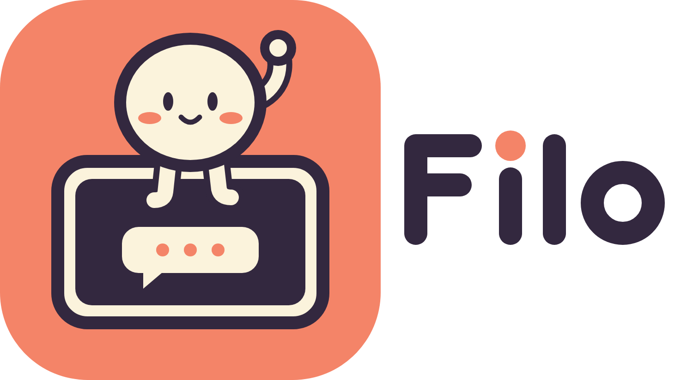

<p align="center"></p>

# Filo

A little desktop pet that lives on your screen. The app is called **Filo** (from the Greek φίλος, "friend"; it was called Companion before); its first character is **Togepi**, drawn in code from a reference sheet of 20 poses (more characters are coming, each in its own folder under `src/characters/`; see the README there). He walks around the bottom of your screen, keeps himself busy, naps, and reacts when you play with him.

> Togepi and the Poké Ball are © Nintendo / Creatures / GAME FREAK / The Pokémon Company. This is a personal fan project: keep it on your own computer and don't publish or distribute builds of it.

## Characters

Four characters, each with its own looks, personality, activities, voice, mind and memories (`src/characters/`):

- **Togepi**, the egg-shell Pokémon: cheerful, impulsive, always curious.
- **Pip**, a tiny clockwork bird who thinks he's much smarter than everyone else: winds himself up when he runs down (if he can't reach his key, click him to wind him), investigates things with a magnifying glass, reads the newspaper, solves his puzzle cube, builds little contraptions and conducts the music you play (Spotify, Apple Music, YouTube Music and other music sites; macOS asks once to let Filo see whether Spotify or Music is playing). Thrown, he checks himself and says "That was unnecessary."; he plays tic-tac-toe with gears and bolts and fetch with a gear.
- **Mori**, a small, quiet forest creature on four stubby legs with a moss cap that grows flowers when he's happy: collects leaves from his heap, plants seeds, goes mushroom hunting (a walk to somewhere new each time), makes tea when he's hungry, skips stones (plop.) and, at night (6 pm to 5 am), watches fireflies. He walks slowly and never gets angry: thrown, he gets dizzy and wanders off, and the third throw in ten minutes gets a "Please don't." sign. Fetch with a pinecone (a leaf may distract him), tic-tac-toe with your leaves against his mushrooms (he wears a mushroom when he wins), and he watches with you with a mug of tea.
- **Nomi**, a little floating dream cloud with a crescent moon on her head: she hovers instead of walking, catches falling stars in a jar when she's hungry (it glows at night), blows dream bubbles (sometimes sillier and sillier: a frog commanding a spaceship), makes a tiny rain cloud when she's sad (pat her and a rainbow appears), paints a rainbow and walks across it, reads a book bigger than she is, watches the moon through a tiny telescope at night (6 pm to 5 am), and now and then tucks her legs in and wanders around the top of your screen for a minute. Thrown hard, she drifts off the screen and floats back dizzy and a little stormy; she never gets angry. Fetch with a dream bubble (it sometimes pops), tic-tac-toe with your stars against her moons (a little constellation when she wins), and she watches with you slightly see-through, peeking round the edge at scary scenes.
- **Tonk**, a pocket-sized brass-and-steel robot who loves helping you get things done (the SBU Hacks "steam and steel" character): a red visor with two glowing eyes, an antenna bulb that glows with his mood, steam vents and wheels for feet. He recharges beside a little steam boiler when he runs low, rolls off with his tiny toolbox, checks things off his to-do list, studies a blueprint, sorts screws into neat piles and tightens his own bolts with a wrench. Thrown, his visor eyes go dizzy for a moment. Fetch with a ball bearing, tic-tac-toe with plugs against his batteries, and he watches with you from behind, his bulb glowing.
- **Wolfie**, the Stony Brook Seawolf (the university's mascot; only for the SBU Hacks demo unless Stony Brook agrees otherwise), in charcoal and light-grey fur, seen from the side and facing whichever way he walks (a big head with a white muzzle and a big toothy grin, a red-and-black eye, big pointed ears poking up through his red Stony Brook cap), muscular arms and legs, in a broad red "STONY BROOK 1" jersey with short sleeves, a little taller than the others: a college buddy who grabs pizza at the dining hall when he's hungry, heads to class with his backpack, studies with a highlighter, pulls an all-nighter with coffee and a laptop (only at night, 6 pm to 5 am), cheers "GO SEAWOLVES!" through a megaphone and busts his game-day moves. Thrown, he shakes himself off and fixes his cap. Fetch with a mini football, tic-tac-toe with your paw prints against his waves, and a dorm watch party with a #1 foam finger.

*Character* in the menu switches between them on the spot (your reminders, water count and settings stay) and *Character → Pick your companion…* opens the picker: hover over one to meet them. A new install shows the picker after the welcome.

## Playing with him

| Do this | He does |
| --- | --- |
| **Click and drag** | Gets picked up and dangles from your cursor, swinging as you move him around |
| **Let go** | Drops to the ground and lands with a squish |
| **Fling him** (drag fast, then let go) | Flies off ("Wheee!") and bounces off the screen edges. A hard landing leaves him **confused** |
| **Throw him 3 times within a minute** | He gets **angry** and stomps off. A pat makes up for it (Mori never gets angry: 3 throws in 10 minutes get a "Please don't." sign; Nomi never gets angry either) |
| **Click him** | A pat on the head: he's **happy** and shows a heart. Wakes him (**surprised**) if he's asleep |
| **Click and hold** (without moving) | **Getting a hug**: eyes closed, arms around himself, hearts while you hold |
| **Leave the cursor resting on him** | He gets **shy**: blushes, with a sweat drop |
| **Leave the cursor near him** | He gets **curious**: "?" |
| **Come back after being away** | He **waves** at you (he also waves when he starts up and wakes up) |
| **Right-click him** or click the **menu bar / tray icon** | Menu: *Come here*, *Activities*, *Do something…*, *Play*, *Take a nap / Wake up*, *Stay put*, *Remind me…*, *Wellbeing*, *Brain*, *Start at login*, *Quit* |

*Stay put* keeps him in one spot for 10 minutes (the menu shows how long is left), then he goes back to wandering and the tick clears itself. Sending him somewhere yourself (*Come here*, or a walking activity from *Activities* or *Do something…*) ends it early.

On his own he walks, runs, **visits your other screens**, **sits**, **blinks** and smiles, **jumps**, **talks**, **eats an apple**, **holds a flower**, **plays with his ball**, **goes on an adventure** with his backpack, turns around to watch your screen (**back view**), **sleeps** and gets **sad**. *Activities* in the menu has his own things (apple, flower, ball, adventure; each character has its own) and *Do something…* the rest.

He walks along the very bottom of each screen (on the laptop, in front of the Dock).

## Games

Two games live in `src/main/games/`. Start one from *Play* in the menu, or wait for him to ask: when he's **getting bored** (but not yet properly bored) he comes over and asks you to play one of them. If you don't take him up on it within **2 minutes** (or you're away), he gives up ("Never mind…") and plays with his own ball instead. Mid-game, 2 minutes without a throw or a move ends the game too. A meeting reminder or a meeting starting puts the game away. *Play → Stop playing* ends it any time.

- **Fetch**: he holds out his Pokeball ("Play fetch?"). Grab it out of his hands and throw it. It flies, bounces off the screen edges (or on into the next screen) and rolls to a stop. Then he runs over, picks it up and brings it back to you: "Again?" You can also grab the ball again while it's rolling or lying on the floor.
- **Tic-tac-toe**: he asks "Tic-tac-toe?"; click him to play. A board appears next to him. Whoever starts plays X, and that alternates every game: sometimes you go first, sometimes he does. He thinks for a moment before each move. He plays well, but not perfectly, so you can beat him. *Play again* starts the next game, × stops.

Playing with him keeps him from getting bored and cheers him up.

## Looking after you

He nudges you now and then, only while you're at the computer: never while you're away or in a meeting (and not in the 5 minutes after one). He does it with **whatever mood he's in**: cheerful he's all smiles ("Water time! 💧"), but when he's sad or cross he still reminds you, just with a frown ("Drink. Water."). Clicking a nudge (or him) counts as a little attention, which he likes.

| Nudge | When | What he does | You |
| --- | --- | --- | --- |
| **Water** | every 45 min at the computer | Walks over with a glass of water | Click it (*Drank ✓*): he has a sip too, and counts your glasses today |
| **Stretch** | after 50 min without a break (5+ min away counts as a break) | Stretches, arms up | Click it (*Done ✓*) |
| **Eye rest** | every 20 min | Shades his eyes and looks far away for 20 seconds: look at something about 20 feet away with him | Nothing: it ends by itself |
| **Bedtime** | after the bedtime you pick (default 23:00), then every 30 min while you're still up | Yawns, sleepy-eyed: "Bedtime soon?" | Click it: "Night!", and he leaves you alone for the night |

Water and stretch wait about 2 minutes for a click; if you don't, he puts it down ("Later then…") and asks again 10 minutes later. Turn each one on or off (and choose the bedtime) under *Wellbeing* in his menu, which also shows how many glasses you've had today. The intervals are in `settings.json` under `nudges`.

**Remind me…** (in his menu): type what to remind you about and pick *in 10 min / 20 min / 30 min / 1 hour / 2 hours* or a time. At that time he brings it over on a sticky note and holds it up until you click it (if you're in a meeting he holds it up where he is; if you're away he shows it when you're back). The same window lists what's coming up, with ✕ to cancel. Notes are kept if you quit or restart.

## His brain

He doesn't pick what to do at random: he has needs and a mood, and notices what's going on around him.

| Need | Goes up / down | What he does about it |
| --- | --- | --- |
| **Energy** | Drains while he's active (faster when running or playing, on low battery, or late at night); refills while he sleeps | Sits more when tired, naps when exhausted |
| **Hunger** | Rises over time | Eats his apple (roughly every 40 min) |
| **Boredom** | Rises while he's sitting around | Plays with his ball or goes on an adventure |
| **Affection** | Fades slowly (about 90 min from loved to lonely); pats and hugs fill it | When lonely he walks over to your cursor and looks up at you, or gets sad. If you keep ignoring him he asks less often (4, 8, 16, 32 min apart); a pat or hug resets that |

His **mood** follows his needs over a few minutes: **content** when they're all fine, **meh** when one isn't (hungry, tired, bored or lonely), **sad** when several aren't or he's very lonely, and **cheerful** when he's been getting lots of affection. Only you change it directly: pats and hugs lift it, throws drop it, and throwing him also makes him **grumpy** for a few minutes. His own activities only help through his needs, so he can't simply cheer himself up.

You can see it on his face while he walks, stands and sits: a big smile when cheerful, a small smile when content, half-closed eyes and a flat mouth when meh, worried brows and a frown when sad (he also walks slower and takes it easy), cross brows when grumpy. When he's tired his eyes droop whatever his mood.

He takes his time: he sits for 12–30 s and hangs out for 6–15 s, and usually rests after a long walk, so he changes what he's doing about every 10–30 s rather than every few seconds.

**What he notices**, with no permissions needed:
- **Time of day:** sleepier at night (and sleeps through), "Good morning!" the first time he sees you each day.
- **Whether you're around:** after 3 minutes without mouse/keyboard, or when the screen locks or the Mac sleeps, he naps. When you come back he wakes up and runs over: "You're back!"
- **Battery:** below 20% he gets tired and slow, below 10% he lies down. Plugging in perks him up: "Yum, power!"

**Opt-in (macOS, off by default)**, under *Brain* in his menu:
- **Notice which app I'm using:** he keeps still only while you're actually in a meeting: as soon as you join one he stops where he is and sits quietly (sitting, resting, watching your screen or napping) until it's over. He hides while you present (Keynote, PowerPoint). Every 3 seconds it checks:
  - the app in front, by name and bundle ID (Zoom, including "Zoom Workplace", Teams, FaceTime, Webex, … is a meeting);
  - which apps have a window showing on **any** of your screens (owner names and positions only, never window contents or titles). A meeting app showing on another screen counts as a meeting **while a calendar event is on**, so a Zoom window left open all day doesn't mute him;
  - the web address of the tab showing in each visible browser window (Chrome, Arc, Brave, Edge, Safari). Google Meet, Zoom web, Whereby and Around tabs count as a meeting; Teams and Webex web count only while a calendar event is on.

  macOS asks once per browser to allow this under *Privacy & Security → Automation*. If you say no, browser meetings just aren't noticed. The app and address lists are in `settings.json`; what you add there is added to the built-in lists.
- **Read my calendar:** reads your next 12 hours of events from the Mac **Calendar** app, so add your Google account there first (*System Settings → Internet Accounts → Google → Calendars on*). **30 minutes** and **5 minutes** before an event he comes over and holds up a sign (**"Meeting in 30 min"**, **"Meeting in 5!"**). The sign stays up until you **click the sign or him** (the green *OK ✓*); if you haven't by the start time it changes to **"Meeting now!"**. If the event has a Zoom, Google Meet, Teams, Webex or Whereby link (in its URL, location or notes), the sign also has a blue **Join ▸** tag that opens the call. When the event is over he drops it, and if you were away he shows it when you come back (if the event's still on). He says "All done!" after. All-day and declined events are ignored. macOS asks once for Calendar access.

  If *Notice which app I'm using* is off he can't tell whether you're really in the meeting, so he keeps quiet for the whole calendar event.

Both only work in the packaged **Filo.app** (see below): macOS only shows these permission prompts to an app that says why it needs them.

Nothing leaves your Mac: no internet, no accounts (the exceptions, only if you switch them on: the weekly song's words, and what you say when you pick ElevenLabs Scribe to listen). His needs, mood, today's water count and your notes are remembered between runs (`characters/togepi/brain.json`) and your choices, including the name he calls you, are in `settings.json`, both in `~/Library/Application Support/Filo/` (also when you run him with `npm start`). Before the app was called Filo this was `…/Companion/`, and before that `…/Togepi/`; the first start of Filo copies everything over (settings, every character's memory, the database) and leaves the old folder alone. Your ElevenLabs and Gemini keys are the exception: macOS locks them to the old app's name, so paste them again. You can edit the meeting / presenting app lists in `settings.json`.

**Show his brain…** (under *Brain*) opens a small window with his needs, mood, what he's noticing and why he chose what he's doing. It also shows how the front app was classified and a *Meeting check* line saying why he is (or isn't) keeping quiet, when your next water / stretch / eye-rest nudges are due, and your pending notes. Problems (for example a declined permission) are shown there too, with when the calendar was last read (every minute, and right away when you open the menu or the brain view or the Mac wakes up). In the *Brain* menu a switch you turned on that macOS hasn't allowed says "(not allowed by macOS)", with *⚠ Fix in System Settings…* under it to open the right page. If you're in an event inside a longer one (a call during a focus block), he shows the call and lists the block under *Also in*.

## His mind

On top of his rule-based brain, Togepi **thinks and talks for himself**, using two AI models that run on your Mac (no internet, no accounts):

- a **language model** (his "voice", Gemma 4 12B) that thinks about what's going on and writes what he might say;
- a **decision model** ([vLLM d3-nano](https://huggingface.co/vllm-sr/d3-nano)) that quickly picks which of those lines fits him best, and double-checks that nothing private slips through.

Both run in llama.cpp's `llama-server`, in background processes listening on `127.0.0.1` only, so his animation never stutters while he thinks. His windows can't reach the internet at all.

**He decides when to talk.** Things wake him up to *think*: you petting, throwing or playing with him (always), something new on your screen, or just every few minutes. He then decides whether he really wants to say something. A chatty personality speaks up more easily; having just spoken, or being ignored the last few times, makes him hold back. What he said, what he chose not to say, and how you reacted (clicked his bubble, petted him, ignored it) all feed into his next decision. His lines are one short sentence of at most 8 words, in a speech bubble; click the bubble to dismiss it. The only hard rules: he's silent in meetings and while you're away, never speaks about private things, and never more than once a minute on his own.

**Sometimes he asks you something.** When he'd rather ask than say, his bubble shows a question and two answers to click (never just yes or no). He comes up with the question and the answers himself. He stands still while he waits; after 30 seconds without an answer he shrugs and lets it go, and if you skip two in a row he stops asking for an hour. He asks one question about what you're doing, then waits until you've moved on to something else; his reaction to your answer is never another question. When you answer he nods and reacts, it makes him happy like a pat, and if the answer tells him something about you he remembers it (Mind → Memories). Nothing on your privacy blocklist is ever part of a question. If neither answer fits, click **✏️** and write your own in the chat window; he reacts to it, remembers it like a clicked answer, and keeps your last few written answers to offer better ones next time.

**Chat with him.** Double-click him (or *Chat with Togepi…* in his menu) to open a chat window. He answers in his own words, one to three short sentences, in a few seconds (if his models were resting they wake up first), knowing his personality, his memories, your notes and what you're doing. His reply also pops up over his head with a chirp (not in meetings or while you watch something). The window shows today's chat and starts fresh the next day; the chat goes into his day, so his diary keeps what matters. Chatting counts like a pat, once per conversation.

**How he remembers.** The 12 most important things he's learned about you are always on his mind (marked ⭐ in *Mind → Memories…*; picked again after each diary). Besides those, for every thought he recalls the 5 memories that fit the moment best (facts, opinions, diary lines, weekly summaries). Every Sunday, with his weekly reflection, he sums up the week from his diary in 3-4 sentences (*His weeks* in the Memories window); diary lines fade from his mind in about a week, weekly summaries and facts in about two months, but nothing is deleted unless you forget it.

**Movie time together.** When you watch something (the playback page of Netflix, YouTube, Prime Video, Disney+, Hulu, Max, Apple TV, Crunchyroll, Hotstar, Peacock, Paramount+, SonyLIV, ZEE5 or Twitch, or VLC, IINA, QuickTime, TV; any other site, or a browser like Firefox that doesn't show him the tab's address, is judged by his decision model from the page's title), he notices after 30 seconds, takes a look (with *Let him read my screen* on), says something about it, walks to the bottom-right corner of the screen it's on and sits there with his back to you, watching too. He stays quiet (no chirps), water, stretch and eye breaks wait, and not touching the mouse for a while doesn't count as being away. 30 seconds after you've stopped he gets up and goes back to his own things. *Show his brain…* has a **Watching check** row that says why he has or hasn't joined you.

While you watch, with *Let him read my screen* on, he **glances at the screen every 2 minutes** and his body reacts to the moment (exciting, funny, sad, scary, beautiful, boring or calm): Togepi leans in, wiggles, droops, hides, sparkles or turns round to look at you, without words or chirps. What he saw goes into his diary as words, never the picture (*Last glance* in his brain view).

**When he's lonely** he walks to just below the window you're working in and looks up at it; if you're busy, he sits down there quietly for a while (with *Notice which app I'm using* off, he stands under your cursor instead).

**He's there for your moments.** His prompt tells him about moments that can matter to you: you finished or submitted something (or you tell him "I did it" in the chat), something went wrong (a rejection, a bad grade, a bad day), or something big is coming up (an interview, an exam). Nothing in the code decides when that happened or what he does: the model reads it from what's on your screen, what you tell him and what he remembers, and his personality decides whether and how he reacts. He may **celebrate** (confetti and a hop), **comfort** you (a hug and hearts), or cheer you on. (Being your **study buddy**, sitting and watching your screen with you while you work, is switched off for now: it kept him too quiet.) The confetti and hearts are particle effects, so every character gets them. The text never names the character and uses the name and pronouns you chose (`src/main/mind/moments.js`).

**His voice is chirps, not words.** He chirps a little "toge-priii" when he talks, with pitch and speed following his mood. To use your own clips instead, put short sound files in `~/Library/Application Support/Filo/characters/togepi/sounds/` named `<mood>-<anything>.<ext>` (mood: `cheerful`, `content`, `meh`, `sad` or `grumpy`; `.wav`, `.mp3`, `.m4a`, `.aac` or `.ogg`), e.g. `cheerful-1.wav`. Files without a mood prefix play for any mood. *Mind → Open sounds folder…* opens it.

**His personality** is 34 traits (the 30 Big Five facets plus 4 Honesty-Humility facets) and 19 values, each 0–100, starting from who Togepi is in the games and anime: very joyful and warm, curious and mischievous, willful, a fearless baby. *Mind → Personality…* opens sliders for all of them; change one and after a few seconds he notices ("Huh? I feel… different!"). His relationship with you (affection, trust, familiarity) starts at "just met". It's all in `personality.md` (numbers at the top, his self-description below), which you can also edit by hand. The research behind it is in [`docs/mind/`](docs/mind/).

**He grows with you.** His relationship with you changes a little every day from what you did together: petting him, playing, clicking his lines and coming back after a break raise affection and trust; throwing him around, ignoring his reminders and his invitations lower them; every day with him around adds familiarity. That's at most ±10 a week each. Once a week (Sunday evening while you're away, or the next time he runs) he looks back on his diary and may change a little: at most ±3 on a trait and ±1 on a value, a few at a time, and never more than 15 away from who he started as (or from where you last put the slider). He also writes down a few things he understood about you. Afterwards he may tell you he feels different.

*Mind → Personality…* has a 🔒 on every slider: a locked slider never grows. **How I've grown** at the top lists each week's changes with his reason ("Warmth 90 → 92: Sushant petted me every morning") and has **Undo this week**. Your own slider changes always win. The same history is in `growth.md` in his mind folder. His personality also sets his resting mood: a gloomier personality settles lower and a more joyful one bounces back faster (Togepi as designed feels exactly as before).

**What he sees** of your screen comes from *Notice which app I'm using* (under *Brain*). He follows your **attention** across windows and screens: the window you're typing in, the window under your cursor, and the other windows that are open. If you've moved the cursor in the last ~15 seconds, he takes it that you're looking at the window under it (reading or scrolling); otherwise at the one you're typing in. A window only counts once your attention has stayed on it ~5 seconds, so moving the cursor across screens doesn't distract him. So when you chat in one app while GitHub is open on your other screen, he knows both. He keeps roaming wherever he likes; he doesn't follow you to the screen you're working on.

**Let him read my screen** (under *Brain*, macOS, off by default) goes further: he reads the window you're looking at.
- One window per look, never a whole screen (whichever screen it's on); when you type in one window and point at another, his looks take turns.
- He looks when your attention settles on a window, then at most every 30 seconds while you stay.
- He reads its text with Apple's on-device text recognition. When there's little text (a picture, a video, a game), and now and then anyway, his language model looks at a picture of the window too.
- He compares what he reads with your notes, e.g. a job description with your skills.
- Nothing from the screen is saved: the picture is deleted straight away and the text is only used for his next thought.
- He never reads private things (the rules below run first), and he doesn't read email or chat apps (Mail, Gmail, Slack, Messages, WhatsApp, Teams, Discord, …) unless you add them to `screenAllow` in `settings.json`; for those he only knows the window title.
- Card numbers, passwords, keys, phone numbers and email addresses are blanked out of what he reads, and his decision model double-checks the rest.
- macOS asks once for **Screen Recording** permission (*System Settings → Privacy & Security → Screen & System Audio Recording*); quit and reopen him after allowing it. The same permission also gives him the titles of all your windows, not just browser tabs. Builds signed with your own certificate keep this permission from one build to the next (see *Signing it once* below); ad hoc builds don't.

**Privacy is built in:** private / incognito windows (Chrome, Arc, Brave, Edge), password managers, payment, checkout and banking pages, money apps, sign-in pages and medical portals are never shown to him; he only notes that "something private" is open. Add your own apps, sites or words to `privacyBlock` in `settings.json` (*Mind → Privacy blocklist…*). Safari doesn't say which of its windows are private, so a private Safari window is only caught by these rules.

**His memory.** Everything lives as plain files in `~/Library/Application Support/Filo/characters/togepi/mind/` that you can read and edit (*Mind → Show his memory folder…*):

- `events.jsonl`: what you were doing, what you did with him, what he said or kept to himself and how you reacted. Kept for 90 days.
- `journal/YYYY-MM-DD.md`: **his diary**, a few lines in his own baby voice, written when you're away at the end of the day (from 6 pm, after 10 minutes away), or the next time he runs for days he missed.
- `about-you.md`: **what he's learned about you** (written with his diary), plus a *Your notes* section for anything you want him to know (your goals, your resume, what you like). He reads your notes but never changes them.
- `about-me.md`: **his own opinions and running jokes**.
- `growth.md` (and `growth.json`): **how he's grown**, week by week, with the reasons.

When he thinks, the few memories that fit best come to mind (how recent, how important and how relevant they are), and he may bring one up: "Amazon again? Third one this week!". Email is only remembered as "read emails", never the subjects, and private things are never stored. *Mind → Memories…* shows everything he remembers, with a × to make him forget something, and a button to write your notes. **Show his brain…** shows his last thought, what came to mind, when he last wrote his diary, and why he spoke or stayed quiet.

**Our weeks in a database (Tiger Data).** Everything in `events.jsonl`, for every character, also goes into a small [TimescaleDB](https://www.tigerdata.com/docs/self-hosted/latest/install) database on your Mac, together with a sample every minute of his mood, his needs and what you're on. It lives in `~/Library/Application Support/Filo/database/` (one for all characters, each row marked with its character), listens only on a socket file in that folder (no network port) and has TimescaleDB's telemetry off. Rows are kept 90 days and move to TimescaleDB's columnstore after 7; hourly totals (continuous aggregates) add up a week in an instant. Older `events.jsonl` lines are loaded automatically on start. It needs Homebrew's Postgres and TimescaleDB (`brew tap timescale/tap && brew install timescaledb`, then `timescaledb_move.sh`); Filo starts and stops its own server. Without them he works as before. **Show his brain…** has a *Database* row.

**Talk to him.** Turn on *Mind → Talk to me*, then press **⌥ Space** (or **🎤** in the chat window) and just talk; he shows 👂 while he listens and stops by himself a second after you stop (press ⌥ Space again to stop sooner). The microphone is never on otherwise, never in meetings or while you're away, and his chirps are muted while he listens. Things from his menu happen right away: "come here", "let's play fetch", "tic-tac-toe", "stop playing", "take a nap", "wake up", "stay put" / "you can move", "remind me in 20 minutes to call mom" (or "at 5 pm"), "make our song", "open the chat", "done" / "I drank water" (while he's holding up a nudge or a note), and any of his activities by name ("go mushroom hunting"). While he's asking you something, saying one of the answers picks it. Anything else is a chat message: he answers in his bubble, as if you'd typed it. What you say is kept like a chat message; the recording itself is deleted as soon as it's turned into text. *Mind → Listen with* picks how: **Apple, on this Mac** (on-device speech recognition; nothing leaves your Mac; built from `src/main/mac/listen.swift` by `npm run build-helpers`, which `npm start` and `npm run dist` run for you; needs Xcode's command line tools, `xcode-select --install`, and macOS asks once for the Microphone and Speech Recognition) or **ElevenLabs Scribe** (online: the recording goes to ElevenLabs, with your ElevenLabs key, which needs *Speech to Text* access). `listenShortcut` and `speechLocale` (e.g. `en-US`) are in `settings.json`; **Show his brain…** has a *Talk to me* row.

**Remembering by meaning.** Every memory (facts, opinions, diary lines, weekly summaries) also gets a meaning fingerprint from a small embedding model on your Mac ([EmbeddingGemma](https://huggingface.co/ggml-org/embeddinggemma-300M-GGUF), ~330 MB, a third `llama-server`), kept in the database with pgvector. When he thinks or chats, what's going on is fingerprinted too and the memories closest in meaning come to mind (still weighed with how recent and important they are), so a job post can remind him that you get nervous before interviews without sharing a word. The index is Tiger Data's StreamingDiskANN (pgvectorscale) when it's installed, otherwise pgvector's HNSW. New and forgotten memories are picked up within a minute; older ones are fingerprinted automatically. It needs `brew install pgvector` and the model (`npm run fetch-models`); without them he remembers by shared words as before. **Show his brain…** says *Remembered (by meaning)*.

**A song about our week (ElevenLabs).** Every Sunday evening (from 6 pm, when you're at the computer) the character on your screen writes a 30-second song about your week: the week in numbers from the database (hours at the computer and in which apps and sites, late nights, pats, throws, games, water, shows you watched, his mood), what it meant from his diary. His own language model writes the title, the lyrics and the music style, only from his personality (Pip's come out snarky, Togepi's sweet), and [ElevenLabs Music](https://elevenlabs.io/docs/api-reference/music/compose) sings it with a sweet female voice (`songSinger` in `settings.json`; never his own voice, which stays chirps). He holds up "I made us a song! 🎵": click it and the song window opens, plays it with the words lit up as they're sung and the week's numbers under them, while he dances. *Mind → Our songs…* has all his songs, the switch (*Make a song every week*, off until you turn it on) and your ElevenLabs key (kept encrypted with your Mac's Keychain; `ELEVENLABS_API_KEY` is used instead when set). *Try it now → Make this week's song now* makes one right away. Only the song's title, lyrics and style are sent to ElevenLabs, after your privacy blocklist and his decision model have checked them; this is the only thing that ever leaves your Mac, and only when you've switched it on. Songs are kept in his memory folder under `songs/` (mp3 + words).

**Light on your Mac.** His two models take about 11 GB of memory while they run, so they rest (stop, freeing the memory and the battery) when you've been away 15 minutes (*Mind → Rest the models after I'm away*: 5, 15, 30 or 60 minutes, or never), at night while he's asleep, and on battery below 20% (`restBattery` in `settings.json`; they come back at 25% or when you plug in). If his diary or weekly reflection is due, he finishes it first. When you're back they start again in a few seconds; meanwhile he behaves as he does without his mind. The Mind menu and **Show his brain…** say when and why they're resting, and the brain view shows how many seconds a thought takes and how much memory the models use.

**His voice on Gemini (optional, online).** On a Mac without room for the local models, his voice model can run on Google's Gemini API instead (`src/main/mind/gemini.js`): his thoughts, chat, diary, weekly reflection and song lyrics go to Gemini, and only the small decision model (about 3 GB) stays on the Mac. It's off unless you turn it on, and then everything in his prompt goes to Google (what you're doing, screen text and pictures if *Let him read my screen* is on, his memories, your notes, the chat); the privacy rules still run first. Get a key at [aistudio.google.com/apikey](https://aistudio.google.com/apikey), choose **Gemini, online** under *How should I think?* in the welcome window (the first time he runs, or *Welcome and what's new…* in his menu) and paste your key there: it's kept encrypted in your Mac's Keychain, like the ElevenLabs key. *Mind → Think with* switches too (**Gemma, on this Mac** to go back). On a new install his models wait until you've chosen, so a smaller Mac doesn't start loading Gemma first. `GOOGLE_API_KEY` / `GEMINI_API_KEY` in your shell are used instead of the saved key when set (testing). Starting him with `MIND_ENGINE=gemini npm start` sets the same choice, and it's kept (`mindEngine` in `settings.json`). Optional settings in `settings.json` under `gemini`: `model` (default `gemini-3.5-flash-lite`), `images` (send the picture of the window, default true), `localDecider` (keep the decision model on the Mac, default true; false runs nothing locally), `generationConfig` (passed to Gemini as is) and `timeoutMs`. The key is never in the repo, the settings or the build.

**Try it now** (in his menu) shows his memory and growth working without waiting for the evening or Sunday: *Write today's diary now*, *Count today towards our relationship now* (the rest of the day is counted when it's over) and *Reflect on this week now* (needs 3 days of diary this week; it counts as this week's reflection and can be undone in Personality…). It wakes resting models if needed.

**Mind → Copy a report** puts a short report on your clipboard to paste into a message when something seems off: versions, how his models are doing, permissions, settings and recent errors. It never includes window titles, apps he saw, screen text, what he said or thought, his memories, your notes or your lists.

**Welcome.** The first time he runs, a welcome window shows what he can do and lets you turn on each permission. After an update it shows once what's new. *Welcome and what's new…* in his menu opens it again.

*Mind → Think and talk for himself* turns it all off (and stops the models); *Chirp when he talks* mutes him. Without the models (or before they've loaded) he behaves exactly as before.

## Running

You need [Node.js](https://nodejs.org/) 18 or newer.

```sh
npm install
npm start
```

He drops onto the bottom of the screen your cursor is on. Choose *Come here* from the menu bar (tray) icon and he runs over to below your cursor.

Run the simulation tests with `npm test`.

### Making Filo.app (macOS)

```sh
npm install
npm run dist
```

The first time, this downloads his mind's engine and models (about 10 GB, into `engine/` and `models/` in the repo; later builds reuse them, and `npm run fetch-models` does just this step). Then it builds `dist/mac-arm64/Filo.app` (or `dist/mac/` on Intel), with the models inside, so the app itself never needs the internet. His mind uses about 11 GB of memory while the app runs; a Mac with 16 GB or more is best. Drag it into **Applications** and open it. It's a personal build that isn't notarized, so the first time macOS may say it can't verify it: **right-click Filo.app → Open → Open**. After that it opens normally.

Then, from his menu: turn on *Start at login*, and under *Brain* turn on the features you want.

#### Signing it once, so macOS remembers its permissions

macOS remembers Screen Recording, Calendar and Automation answers by the app's signature. Signed ad hoc (the default without a certificate), every rebuild looks like a new app: System Settings still shows Filo switched on, but the new build isn't allowed and macOS doesn't ask again. To fix this for good, once on your Mac:

```sh
npm run make-cert          # makes "Companion Local Signing" in your login keychain; asks for your password once
npm run reset-permissions  # forgets the answers macOS kept for the old ad hoc builds
npm run dist               # now signed with your certificate
```

Then quit Filo, open the new build and allow what it asks for (turn the switches off and on under *Brain* if it doesn't ask). From then on every `npm run dist` is signed the same way and keeps the permissions. If macOS asks whether `codesign` may use the key while building, choose **Always Allow**. The certificate is self-signed and stays on your Mac; it's only good for your own builds. `npm run dist` says which signature it used; *Copy a report* shows it too.

## Platform notes

- **Windows / macOS**: clicks pass straight through the empty space around him, so only his body catches the mouse.
- **Linux**: transparency needs a compositing window manager, which most modern desktops have. On X11 Electron can't reliably track the cursor while a window lets clicks through, so his small window (220×240) stays clickable.
- **Multiple monitors**: he knows how your screens are arranged. He stays on the screen he's on for a while (at least 5 minutes), then sometimes wanders over to another one on his own, always walking through the edge where they touch, never popping up in the middle. When you plug in a screen he stays where he is, and when you come back after a break he comes over to the screen you're on. The brain view (*Brain → Show his brain…*) shows which screens he can walk to. Side by side he walks across, drops down to a lower screen or hops up to a higher one; between stacked screens he drops through the shared edge or springs up through it. *Come here* on another screen makes him walk over the same way. Screens that don't touch can't be walked between (*Come here* then drops him in from above). You can also carry him anywhere. When thrown, he bounces off the edges of the monitor he's on.

## Making him your own

- `src/main/brain.js`: `NEEDS` sets how fast his needs change, `EFFECTS` what each shared activity does to them, and `scoreActivities()` how much he wants to do each thing. His own activities (effects, appeal) are in `src/characters/togepi/index.js`.
- `src/main/companion.js`: `TUNING` sets speeds, gravity, bounciness and how soon he gets curious, shy or angry.
- `src/characters/togepi/look.js`: `PALETTE` sets his colours. `FRONT_SPIKES` / `BACK_SPIKES`, `zigzag()` and `MARKS_FRONT` set his head spikes, shell edge and shell markings. The drawing functions set his expressions and props.
- `src/renderer/renderer.js`: `computePose()` maps each state to a pose and expression, and also has the particle effects.

## How it works

```
src/
  characters/          one folder per character: who it is, its activities (index.js),
                       how it looks (look.js), its chirps (voice.js), its fixed lines
  creator/             the character creator: personality, the simulation in a little world, scenes
  main/creator.js      serves the character creator, in the app and for `npm run creator`
  main/companion.js    behaviour state machine + physics (plain JS, unit-tested)
  main/brain.js        needs, mood and how he scores what to do next
  main/context.js      turns idle time, battery, clock, front app and calendar into context
  main/settings.js     opt-in settings (settings.json)
  main/screens.js      screen layout: which screens touch and how to cross between them
  main/nudges.js       water / stretch / eye rest / bedtime timers, "remind me" notes, what he says
  main/games/          fetch (the ball's physics) and tic-tac-toe (rules and his moves)
  main/mind/           his own mind: personality, event log, privacy gate, the think/decide
                       loop, memory (diary, facts, recall), growth (relationship, weekly
                       reflection), attention across windows and screens, reading the
                       screen, llama-server engine and when it rests, your sound clips,
                       the Tiger Data database (store.js), the weekly song (song.js),
                       voice commands (commands.js, hearing.js)
  main/migrate.js      copies the data from before the app was called Filo (Companion, Togepi)
  main/report.js       "Copy a report" (nothing private)
  main/welcome.js      the welcome window's words and what's new in each version
  main/mac/            macOS-only: front app (lsappinfo), visible windows (CoreGraphics),
                       browser tabs (AppleScript), calendar (EventKit), window pictures
                       (screencapture) and their text (Vision, ocr.applescript)
  main/main.js         Electron main: transparent always-on-top window that follows him,
                       60 Hz loop, cursor polling for dragging, tray + menus, saving his brain
  preload.js           small IPC bridge (game-preload.js: the same for the ball and the board)
  renderer/            canvas drawing, animation, particles, mouse input, brain view
  renderer/games/      the thrown ball's window and the tic-tac-toe board
  renderer/ui.js       bubbles, signs, hearts and floating text around any character
  renderer/chirp.js    plays his chirps (Web Audio) with the character's voice
  renderer/personality.*  the personality sliders, locks and growth history
  renderer/memories.*  the Memories window
  renderer/welcome.*   the welcome / what's new window
scripts/fetch-models.js  downloads llama-server and the models for `npm run dist`
scripts/sign.js          signs the built app (your certificate, or ad hoc without one)
scripts/make-signing-cert.sh, reset-permissions.sh  the one-time signing setup (see above)
docs/mind/             the plan, decisions and research for his mind
test/                  node:test tests for the simulation
skills/                the new-character skill for Claude Code and Codex (see below)
```

The window is a small transparent square that moves with him. The main process runs the simulation and moves the window. The renderer draws him from the state it receives each frame and sends mouse input back.

## Making a new character

The repo comes with a skill, [`skills/new-character/`](skills/new-character/SKILL.md), that walks [Claude Code](https://claude.com/claude-code) or [Codex](https://developers.openai.com/codex) through making a character with you, from a sentence to a character you can play with. Both pick it up on their own when you open the repo (`.claude/skills/` and `.agents/skills/` link to it).

1. Open the repo in Claude Code or Codex and ask for one, for example *"Make a new character: a sleepy otter who loves sea shells"*. You can also call the skill by name: `/new-character` in Claude Code, `$new-character` in Codex.
2. It asks for its name, its pronoun and what it is or how it looks (a sentence, its style, or a picture or sketch), then fills in everything else itself: its look, personality sliders, "Who I am", activities for each need, how it acts when thrown, its games and its voice. You get a short summary, with a few words on why for its strongest traits. Change anything you like.
3. It builds the character and opens it in the **character creator**:
   - in Filo, if you run it from the repo (`npm start`): `npx electron . --creator=<id>` opens the creator in the running app;
   - or in your browser, without Filo: `npm run creator`, then http://localhost:5178/?character=<id>. It reloads by itself whenever a file changes.

   **Personality** shows who it is, slider by slider; **Simulation** lets it loose in a little world where you can pick it up, throw it, pat it, change its needs and ask it to do anything; **Scenes** plays every state and activity. *Debug* (bottom right) adds every frame field and pose by hand.
4. Go through it part by part (the look, how it moves, its activities, its personality, its voice, its lines) and say what to change; each change shows up in the creator.
5. At the end it runs the tests and adds the character to the welcome window's what's new. Try it for real: `npm start`, then *Character* in the menu.

The same creator is in the app for every character: *Character → Pick your companion…*, hover over one and click **More info**.
